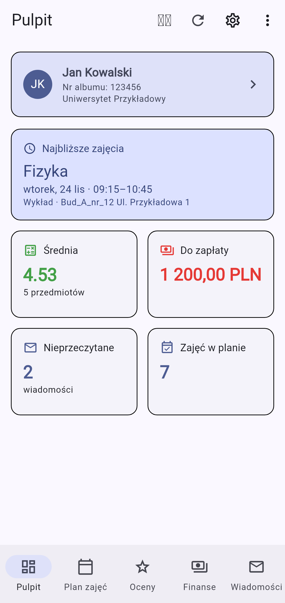
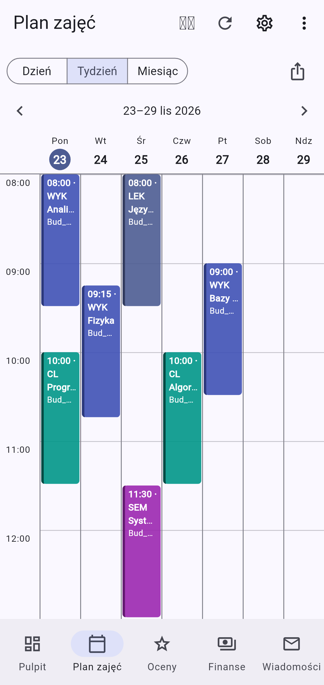
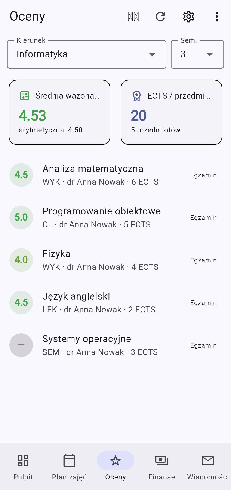
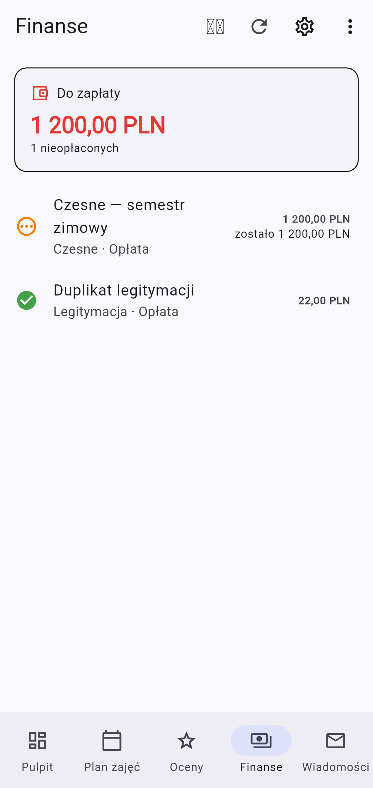
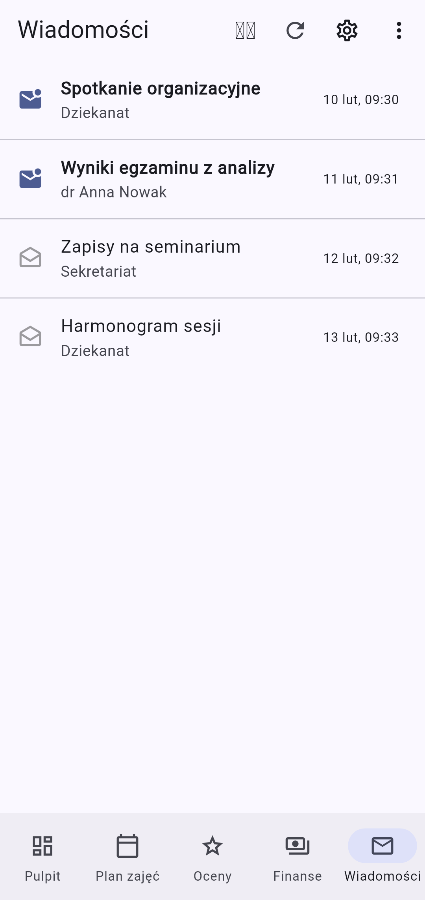

# Kulindeks

*Read this in: **English** · [Polski](README.pl.md)*

**An independent, open-source client for the mStudent university app's API** — plus
the reverse-engineering work and tooling used to recover that API.

[](LICENSE)


> Independent project. **Not affiliated with, endorsed by, or connected to
> Simple S.A. or any university.** "mStudent" is used only to name the API this
> app talks to. Use it with your own account against your own university.

Poland's **mStudent** app (by Simple S.A.) is a thin, closed Flutter client that
many universities use for grades, timetables, finances and messages. Kulindeks is
a cleaner, faster, open client for the same backend — built on a fully
reverse-engineered map of its API.

## AI disclosure

The project is quite obviously mostly vibe-coded. This may be a flaw to you, but
in my opinion it is still better than the original client. I have done my best to
ensure it is as safe as possible. Approach with caution.

## How to install it (on your phone)

No tech knowledge needed — it's just a few taps.

1. **On your phone**, open this page:
   [**Releases → latest**](https://github.com/pan-kuleczka/kulindeks/releases/latest).
2. Under **Assets**, tap **`kulindeks-…-arm64-v8a.apk`** to download it.
   (This is the right one for almost every phone. If it refuses to install, try
   the `…-universal.apk` instead.)
3. Open the downloaded file (tap the download notification, or find it in your
   **Files / Downloads**). Your phone will ask to **allow installing unknown
   apps** — tap **Settings → allow**, then go back and tap **Install**. You only
   have to do this once.
4. Your phone may show a scary-sounding warning like *"app from an unknown
   source"* or *"Play Protect didn't recognise this app"* — this is normal for
   apps that aren't on the Play Store. Choose **Install anyway / More details →
   Install**.
5. Open **Kulindeks** and log in with your **university login and password**.

**Important — the login is NOT your e-mail.** Use the same username you'd use for
your university's mStudent / Wirtualna Uczelnia (often something like
`name.surname`). If you type an e-mail, the app will warn you — remove the
`@...` part.

If you ever want to remove it, just long-press the app icon → **Uninstall**, like
any other app. Nothing is left behind.

> Your login and password are stored **only on your phone** and are sent **only
> to your own university's server** — never to anyone else. The app has no ads
> and no tracking.

## Screenshots

<p align="center">
  
  
  
  
  
</p>

<sub>Screenshots use mock data and are generated from
`app/test/screenshots_test.dart`.</sub>

---

## The app

A Flutter client for **Android and Linux desktop**:

- **Dashboard** — identity card, next class, GPA, outstanding dues, unread messages (every tile taps through to its section).
- **Timetable** — a real calendar with Day / Week / Month views, events laid out on a time grid, swipe navigation, room maps (the API returns room GPS), `.ics` export, and one-tap **Nextcloud (CalDAV) sync**.
- **Grades** — ECTS-weighted and arithmetic averages, color-coded, per programme/semester.
- **Finances** — dues and scholarships.
- **Messages** — inbox with read/unread and full message view.
- **Quality of life** — instant cached loads (refreshes in the background), light/dark/high-contrast themes, a custom accent color, adjustable font size, **Polish & English**, class reminders (local notifications), and a clear **offline** indicator that keeps showing cached data.

Prebuilt APKs are on the [Releases](https://github.com/pan-kuleczka/kulindeks/releases)
page; to build from source see **Quick start** below.

## The protocol

The API is documented from scratch in [`docs/protocol.md`](docs/protocol.md):
university discovery, JWT auth, and every endpoint with its parameters and
response shapes — confirmed against live traffic.

**TL;DR**
- Universities and their API base URLs come from an XOR+base64 blob at
  `mlicenses.simple.com.pl/ifhavemstud.php` (key recovered from the binary).
- `POST {base}/api/auth` `{login, password, applicationName:"mStudent"}` → a Bearer
  JWT plus the student's numeric IDs.
- Data lives under `{base}/automatic/rest/mStudent/bazus/wsrest/rest/edu/api/...`,
  authorized with `Authorization: Bearer <token>`.

[`tools/discovery.py`](tools/discovery.py) decrypts the university directory, and
[`tools/mstudent_client.py`](tools/mstudent_client.py) is a dependency-free Python
reference client you can run against your own account.

## Repository layout

| Path | What |
|---|---|
| `app/` | The Kulindeks Flutter app (Android + Linux). |
| `docs/protocol.md` | The reverse-engineered API reference. |
| `docs/RUNBOOK.md` | How the live capture was reproduced (Waydroid MITM, TLS + pinning bypass). |
| `tools/` | Discovery decryptor, Python reference client, and the capture rig. |
| `sync/` | Headless Nextcloud auto-sync daemon (CalDAV, cron/systemd). |

## Quick start

```bash
# Decode the university directory (no account needed)
python3 tools/discovery.py

# Pull your own data via the Python reference client
MST_LOGIN=you MST_PASSWORD=... python3 tools/mstudent_client.py --college umw --dump all

# Run the app from source (needs Flutter)
cd app && flutter pub get && flutter run
```

## Legal & privacy

- **Unofficial.** No affiliation with Simple S.A. or any university; no vendor
  branding, logos, or assets are redistributed here.
- **Your data stays yours.** The app talks only to your university's server with
  your own credentials and caches data locally on your device. Nothing is sent
  anywhere else; there is no analytics or telemetry.
- Credentials are stored on-device only.

## License

[GNU GPL v3](LICENSE). You're free to use, study, modify and redistribute it;
distributed modified versions must also be open-sourced under the GPL.
