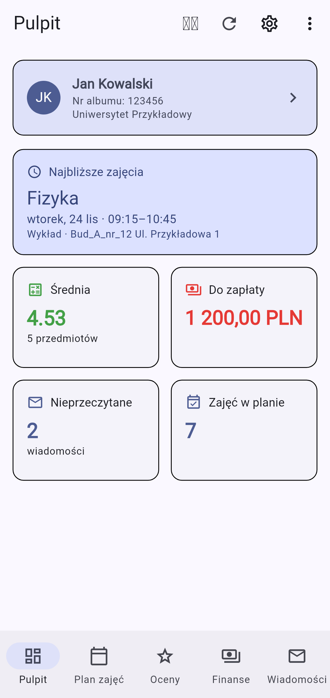
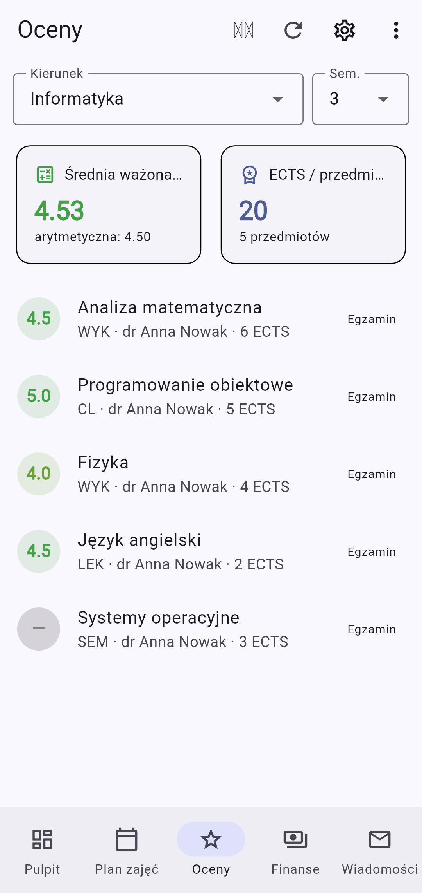
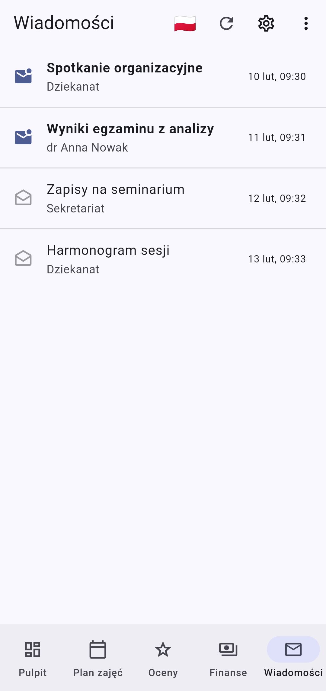
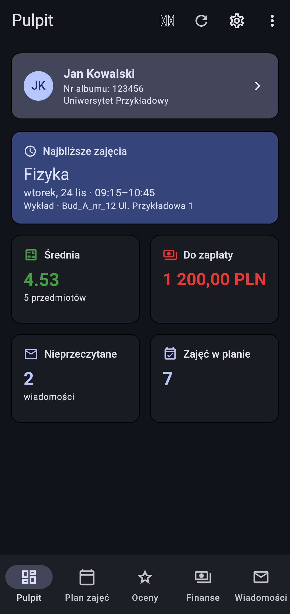
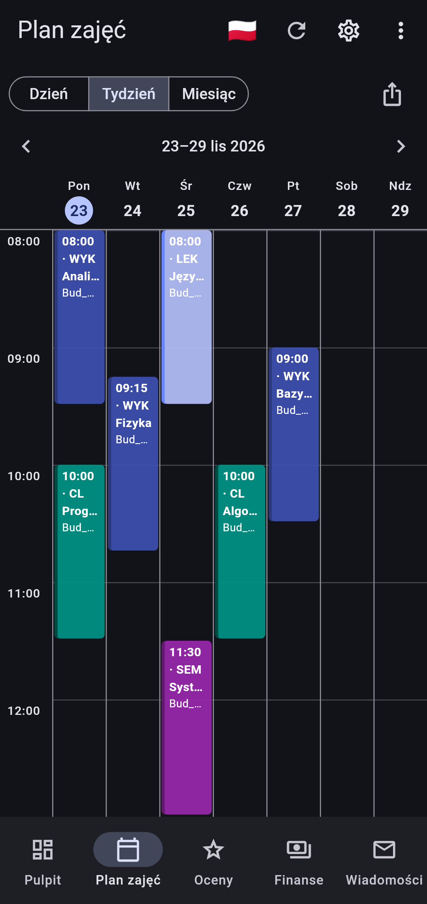
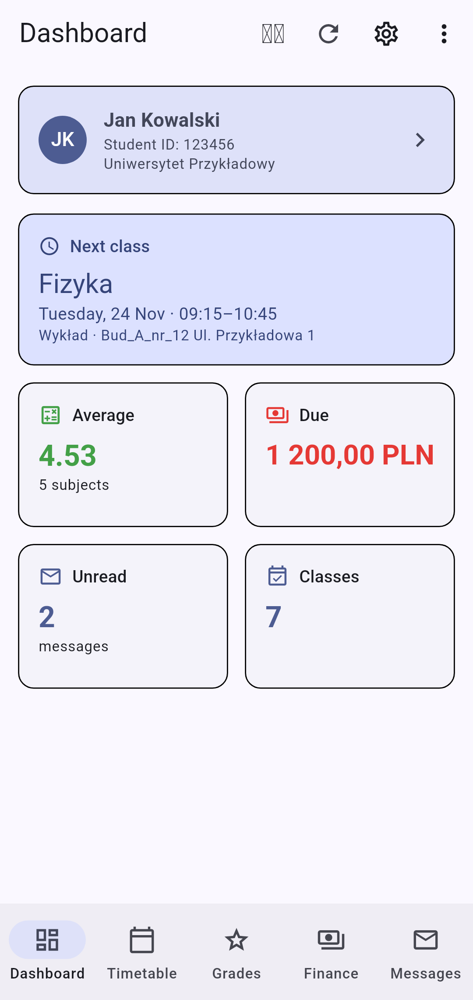
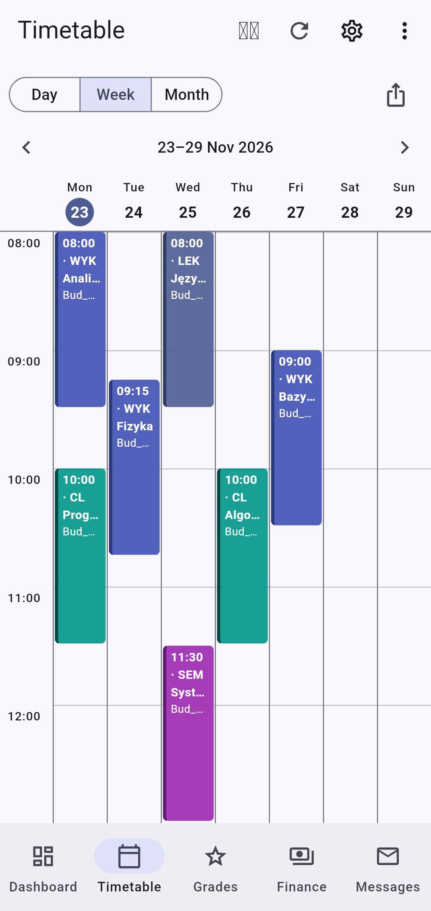

<p align="center"></p>

# Kulindeks

*Przeczytaj w języku: [English](README.md) · **Polski***

**Niezależny klient open source do API aplikacji uczelnianej mStudent** — wraz z
pracą nad inżynierią wsteczną i narzędziami użytymi do odtworzenia tego API.

[](LICENSE)


> Projekt niezależny. **Niepowiązany z Simple S.A. ani żadną uczelnią, ani przez
> nie wspierany.** Nazwa „mStudent" jest użyta jedynie po to, by wskazać API, z
> którym rozmawia ta aplikacja. Używaj jej z własnym kontem na swojej uczelni.

Polska aplikacja **mStudent** (firmy Simple S.A.) to zamknięty, prosty klient
Flutter, z którego wiele uczelni korzysta do ocen, planu zajęć, finansów i
wiadomości. Kulindeks to czytelniejszy, szybszy i otwarty klient tego samego
zaplecza — zbudowany na w pełni odtworzonej mapie jego API.

## Zastrzeżenie o AI

Projekt jest dość oczywiście w większości „vibe-coded" (tworzony na wyczucie z
pomocą AI). Dla Ciebie może to być wada, ale moim zdaniem i tak jest lepszy niż
oryginalny klient. Dołożyłem starań, aby był możliwie bezpieczny. Zachowaj
ostrożność.

## Jak to zainstalować (na telefonie)

Nie trzeba wiedzy technicznej — to tylko kilka dotknięć.

1. **Na telefonie** otwórz tę stronę:
   [**Releases → najnowsze**](https://github.com/pan-kuleczka/kulindeks/releases/latest).
2. W sekcji **Assets** dotknij **`kulindeks-…-arm64-v8a.apk`**, aby pobrać plik.
   (To właściwa wersja dla niemal każdego telefonu. Jeśli nie da się zainstalować,
   spróbuj pliku `…-universal.apk`.)
3. Otwórz pobrany plik (dotknij powiadomienia o pobraniu albo znajdź go w
   **Pliki / Pobrane**). Telefon poprosi o **zezwolenie na instalację nieznanych
   aplikacji** — dotknij **Ustawienia → zezwól**, wróć i dotknij **Instaluj**.
   Trzeba to zrobić tylko raz.
4. Telefon może pokazać groźnie brzmiące ostrzeżenie w stylu *„aplikacja z
   nieznanego źródła"* lub *„Play Protect nie rozpoznał tej aplikacji"* — to
   normalne dla aplikacji spoza Sklepu Play. Wybierz **Zainstaluj mimo to /
   Więcej szczegółów → Zainstaluj**.
5. Otwórz **Kulindeks** i zaloguj się swoim **loginem i hasłem uczelnianym**.

**Ważne — login to NIE jest Twój e-mail.** Użyj tej samej nazwy użytkownika, co w
uczelnianym mStudent / Wirtualnej Uczelni (często w stylu `imie.nazwisko`). Jeśli
wpiszesz e-mail, aplikacja Cię ostrzeże — usuń część `@...`.

Gdybyś chciał(a) ją usunąć, po prostu przytrzymaj ikonę aplikacji →
**Odinstaluj**, jak każdą inną. Nic nie zostaje.

> Twój login i hasło są przechowywane **tylko na Twoim telefonie** i wysyłane
> **wyłącznie do serwera Twojej uczelni** — nigdzie indziej. Aplikacja nie ma
> reklam ani śledzenia.

## Zrzuty ekranu

<p align="center">
  
  
  
  
</p>

**Motyw ciemny i interfejs angielski:**

<p align="center">
  
  
  
  
</p>

<sub>Zrzuty korzystają z danych przykładowych i prawdziwej czcionki Androida
(Roboto); generowane przez `app/test/screenshots_test.dart`.</sub>

---

## Aplikacja

Klient Flutter na **Androida i pulpit Linux**:

- **Pulpit** — wizytówka studenta, najbliższe zajęcia, średnia, należności do zapłaty, nieprzeczytane wiadomości (każdy kafelek prowadzi do odpowiedniej sekcji).
- **Plan zajęć** — prawdziwy kalendarz z widokami Dzień / Tydzień / Miesiąc, zajęcia rozmieszczone na siatce godzin, przewijanie gestem, mapy sal (API zwraca GPS sali), eksport `.ics` oraz synchronizacja z **Nextcloud (CalDAV)** jednym dotknięciem.
- **Oceny** — średnia ważona ECTS i arytmetyczna, z kolorami, dla kierunku/semestru.
- **Finanse** — należności i stypendia.
- **Wiadomości** — skrzynka z oznaczeniem przeczytane/nieprzeczytane i podglądem treści.
- **Wygoda** — błyskawiczne ładowanie z pamięci (odświeżanie w tle), motywy jasny/ciemny/wysoki kontrast, własny kolor akcentu, regulacja wielkości czcionki, **polski i angielski**, przypomnienia o zajęciach (powiadomienia lokalne) oraz czytelny wskaźnik **trybu offline**, który dalej pokazuje dane z pamięci.

Gotowe pliki APK są na stronie
[Releases](https://github.com/pan-kuleczka/kulindeks/releases);
aby zbudować ze źródeł, zobacz **Szybki start** poniżej.

## Protokół

API jest udokumentowane od zera w [`docs/protocol.md`](docs/protocol.md):
wykrywanie uczelni, uwierzytelnianie JWT oraz każdy endpoint wraz z parametrami i
kształtem odpowiedzi — potwierdzone na żywym ruchu sieciowym.

**W skrócie**
- Uczelnie i ich adresy bazowe API pochodzą z zaszyfrowanego (XOR+base64) bloku
  pod `mlicenses.simple.com.pl/ifhavemstud.php` (klucz odzyskany z binarki).
- `POST {base}/api/auth` `{login, password, applicationName:"mStudent"}` → token
  JWT (Bearer) oraz numeryczne identyfikatory studenta.
- Dane są pod `{base}/automatic/rest/mStudent/bazus/wsrest/rest/edu/api/...`,
  z autoryzacją `Authorization: Bearer <token>`.

[`tools/discovery.py`](tools/discovery.py) odszyfrowuje katalog uczelni, a
[`tools/mstudent_client.py`](tools/mstudent_client.py) to bezzależnościowy
referencyjny klient w Pythonie, który możesz uruchomić na własnym koncie.

## Układ repozytorium

| Ścieżka | Co |
|---|---|
| `app/` | Aplikacja Flutter Kulindeks (Android + Linux). |
| `docs/protocol.md` | Odtworzona dokumentacja API. |
| `docs/RUNBOOK.md` | Jak odtworzono przechwytywanie ruchu na żywo (MITM w Waydroid, obejście TLS i pinningu). |
| `tools/` | Deszyfrator katalogu, referencyjny klient w Pythonie i zestaw do przechwytywania. |
| `sync/` | Bezobsługowy demon auto-synchronizacji z Nextcloud (CalDAV, cron/systemd). |

## Szybki start

```bash
# Odszyfruj katalog uczelni (konto niepotrzebne)
python3 tools/discovery.py

# Pobierz własne dane referencyjnym klientem w Pythonie
MST_LOGIN=ty MST_PASSWORD=... python3 tools/mstudent_client.py --college umw --dump all

# Uruchom aplikację ze źródeł (wymaga Fluttera)
cd app && flutter pub get && flutter run
```

## Kwestie prawne i prywatność

- **Nieoficjalny.** Brak powiązania z Simple S.A. czy jakąkolwiek uczelnią; nie
  rozpowszechnia się tu żadnych znaków firmowych, logo ani zasobów producenta.
- **Twoje dane należą do Ciebie.** Aplikacja łączy się wyłącznie z serwerem Twojej
  uczelni, używając Twoich danych logowania, i przechowuje dane lokalnie na
  urządzeniu. Nic nie jest wysyłane gdziekolwiek indziej; brak analityki i
  telemetrii.
- Dane logowania są przechowywane wyłącznie na urządzeniu.

## Licencja

[GNU GPL v3](LICENSE). Możesz swobodnie używać, analizować, modyfikować i
rozpowszechniać ten program; rozpowszechniane zmodyfikowane wersje również muszą
być otwartoźródłowe na licencji GPL.
